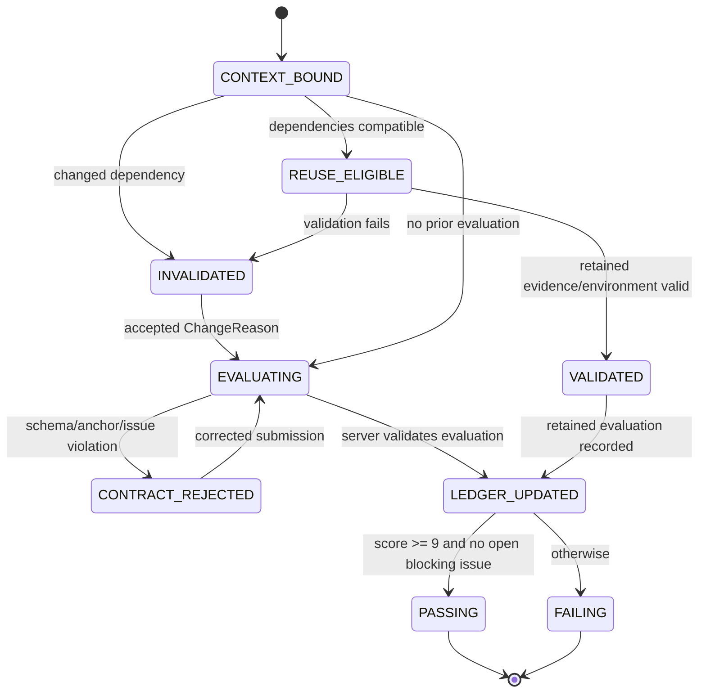

# strict-goal round・時間・token削減 設計仕様

## 1. 背景、根拠の境界、決定

### 1.1 解決する問題

strict-goal は品質を下げずに、不必要な採点 round、同一指摘の反復、条件変更後の不当な再評価拒否を減らす。対象は strict-goal MCP サーバーと、その設計・計画・実装フェーズに共通する採点契約である。

本設計の優先順位は次のとおりとする。

1. 9 点 anchor に拘束された採点契約をサーバーで検証する。
2. 全不合格を固定 issue ID で追跡し、作業指示の上位 3 件とは分離する。
3. 条件変更を明示した、基準単位の再評価と依存付きキャッシュ再利用を導入する。
4. クライアント差を吸収する共通 verifier 契約と、効果を測る観測を導入する。

### 1.2 確認済みの現状事実

以下は `docs/gougi/2026-10-16-strict-goal-round-reduction.md` とそこで参照される現行ソースの調査記録に基づく。実装後の挙動を表すものではない。

- idle-talk の指定事例は design 13、plan 11、implement 13、合計 37 round を記録し、読める採点 JSON は 35 件だった。欠落した採点内容を推測で補わない。
- 現行の合格条件は全 criterion が 9 点以上かつ加重平均 9 点以上である。作業用 `must_fix` は優先度等で上位 3 件に絞られる。
- `score_submit.js` は全 criterion の採点を扱う一方、作業状態へ投影される詳細な修正指示は上位 3 件に限られる。
- `anti_gaming.js` の `E_SCORE_INFLATION` は同じ artifact digest の加点を拒否し、`E_EVIDENCE_STALE` は証拠 digest 集合の一致を拒否する。これは上流、scope、rubric、実行環境が変化した正当な再評価と衝突し得る。
- `chain/rebase.js` は上流引用の有無を扱うが、引用が残ることだけでは paths、受入条件、検証環境、非対象範囲の意味的不変性は証明できない。
- 指定事例には、9 点 anchor 外の理由で 8 点とされた後、同種の条件のまま 9 点となった記録がある。これが round 増加の唯一又は全体の主因とは未証明である。
- Claude と Codex の verifier 指示量・反例 probe の差は確認されているが、モデル差又は token/round 差との因果は未証明である。
- `first_round_ceiling=8` は policy/default/schema に存在するが、調査した現在の採点経路に同名上限の直接強制は確認されていない。初回不合格強制と混同しない。

### 1.3 提案であり未検証のこと

本書の state、スキーマ、エラー、移行、測定値、受入条件は提案である。実装前に対象 revision の `strict-goal/server`、preset、schema、テスト、および実際の MCP 起動元を再確認する。本文は `strict-goal/server/src/tools/score_submit.js`、`src/judge/anti_gaming.js`、`src/chain/rebase.js`、`src/skill_state/projector.js`、各 preset/schema、verifier agent 定義を変更候補として名指しするが、本設計では変更しない。

### 1.4 現行根拠の再現手順と提案との境界

次は **2026-10-17 にこの checkout で確認した現行事実** だけを再現する read-only command である。`strict-goal/server/package.json` は Node `>=20` と `node --test` を定義し、実在する schema directory は `strict-goal/server/schemas/`、preset directory は `strict-goal/presets/` である。`score_submit.js`、`anti_gaming.js`、`rebase.js`、`projector.js` は本文で挙げた実在パスであり、`anti_gaming.test.js` は `E_SCORE_INFLATION` と `E_EVIDENCE_STALE` を、`score_submit.test.js` は min score と weighted mean の FINAL 条件を検査している。

```powershell
node --test strict-goal/server/test/anti_gaming.test.js strict-goal/server/test/score_submit.test.js strict-goal/server/test/rebase.test.js strict-goal/server/test/skill_state_projector.test.js
```

この command の成功は現行四領域の回帰テスト成功だけを意味する。本書の v2 manifest、ledger、dependency graph、追加 error code、policy、CI、測定値はすべて **提案** であり、現行実装済み又は runtime で検証済みとは主張しない。以下で `target:` と書く path は導入時に新設する target で、現在存在するという引用ではない。

## 2. 目的と非目的

### 2.1 目的

- 9 点未満の採点を、未達 anchor 条項、固定 issue、根拠、解消条件へ結び付ける。
- 全未解決 issue を失わずに保持し、次作業は有限な上位 3 件にする。
- artifact が不変でも、承認・監査可能な入力条件の変更により影響を受けた criterion だけ再評価できるようにする。
- 不変な依存関係を持つ通過 criterion の無駄な再実行を避ける。
- 人為的な scope 縮小、rubric 緩和、証拠言い換えによる不当な加点を防ぐ。
- round、token、実行時間、承認待ちを分離して測り、少数事例でも品質低下を検出できるようにする。

### 2.2 非目的

- 合格閾値を 9 点から一律に下げない。
- round 上限の単純な増加、又は既知 issue 以外の発見禁止を行わない。
- LLM の自由な批評を禁止しない。anchor 外の所見は合否と区別して残す。
- 過去の欠落 round を復元又は推測しない。
- クライアントごとの文章量を一律化しない。統一対象は判定契約、必須 evidence、probe の適用条件である。
- FINAL の判定権をクライアント、verifier、又は設計書へ移さない。サーバーだけが FINAL を返す。

## 3. 用語とデータ契約

| 用語 | 契約 |
|---|---|
| evaluation context | `{artifact_digest, upstream_digests, scope_digest, rubric_digest, evidence_set_digest, verification_env_digest}`。各 digest は SHA-256 の小文字 64 桁。 |
| criterion | preset 内の一意な criterion ID。score、anchor、依存宣言、issue 参照を持つ。 |
| anchor clause | 9 点を満たすための条項 ID。criterion 内で一意な `criterion_id:clause_id` とする。 |
| blocking issue | 9 点を妨げる issue。9 点未満の criterion は少なくとも一つ参照する。 |
| advisory finding | 合否を妨げない改善案又は残余リスク。score を下げず、issue close を阻害しない。 |
| issue ledger | session/chain に属する固定 ID の全 issue 集合。`must_fix` はそこから選ぶ表示である。 |
| dependency declaration | criterion の判定に影響する artifact path、上流契約、scope section、rubric clause、evidence 種別、verification environment の集合。 |
| reuse | 前回の score/evidence を、新 context が依存集合と互換であるため再利用すること。 |
| re-evaluation | context の変更により、影響する criterion を新たに採点すること。 |

### 3.1 `IssueRecord` v1

```json
{
  "id": "ISS-implement-docs_updated-0042",
  "criterion_id": "docs_updated",
  "anchor_clause_ids": ["docs_updated:A2"],
  "severity": "blocking",
  "state": "open",
  "first_seen": {"session_id": "...", "round": 3, "context_digest": "..."},
  "last_evaluated": {"session_id": "...", "round": 5, "context_digest": "..."},
  "locator": {"path": "README.md", "line": 42},
  "claim": "...",
  "evidence_refs": ["ev-..."],
  "resolution_condition": "...",
  "dependency_keys": ["artifact:README.md", "scope:docs", "env:test-selection"],
  "duplicate_of": null,
  "history": [{"event": "opened|reaffirmed|resolved|reopened|superseded", "at": "RFC3339"}]
}
```

`severity` は `blocking`、`major`、`advisory` のいずれかである。`blocking` だけが 9 点未満の根拠になれる。`major` を blocking として採点に使うには、anchor clause と解消条件を付けて昇格イベントを監査ログに残す。`advisory` は合否に使えない。

ID はサーバーが採番する。verifier は既存 ID への関連付け候補を返せるが新 ID、重複、close を単独で確定できない。`criterion_id`、正規化 locator、最初の claim digest を ID の安定キーにし、内容が近い候補は `duplicate_candidates` として返す。曖昧な候補は新規発見扱いにせず `needs_triage` として人又は次採点へ回す。

### 3.2 `CriterionEvaluation` v2

```json
{
  "criterion_id": "docs_updated",
  "score": 8,
  "anchor_status": [{"id": "docs_updated:A2", "status": "unmet", "evidence_refs": ["ev-7"]}],
  "blocking_issue_ids": ["ISS-implement-docs_updated-0042"],
  "advisory_issue_ids": [],
  "dependency_declaration": {
    "artifact_paths": ["README.md", "docs/**"],
    "upstream_contract_ids": ["plan:AC-03"],
    "scope_ids": ["scope:documentation"],
    "rubric_clause_ids": ["docs_updated:A2"],
    "evidence_kinds": ["command"],
    "verification_env_keys": ["node", "test-selection"]
  },
  "basis": "fresh|reused|re_evaluated|corrected",
  "change_reason_ids": ["CR-..."],
  "context_digest": "..."
}
```

サーバーは `score < 9` なら `blocking_issue_ids` 非空、各 blocking issue の `anchor_clause_ids` 非空、evidence と解消条件非空を要求する。`score >= 9` で blocking issue が未解決なら拒否する。10 点の `weakness: none` 制約は互換期間中のみ保持し、9 点では「合格阻害 issue なし」と advisory を別欄に書ける。

### 3.3 変更理由 `ChangeReason`

許可値は `artifact_change`、`evidence_change`、`upstream_finalized_change`、`scope_change`、`rubric_change`、`environment_change`、`evaluation_correction` である。各理由は変更前後 digest、差分 locator、影響 dependency key、申請者、時刻を持つ。

- `artifact_change` は差分と該当 artifact path を必須とする。
- `evidence_change` は新規 command/evidence が claim を直接検証することを必須とする。単なる文字列存在確認は不可とする。
- `upstream_finalized_change` は FINAL 済み上流 digest と変更された契約 ID を必須とする。
- `scope_change`、`rubric_change`、`environment_change` は承認 record を必須とし、品質改善とは別の `condition_changed` として記録する。
- `evaluation_correction` は前回評価の具体的な矛盾と独立 verifier 又は再現可能な機械根拠を必須とする。

## 4. 採点と issue 台帳の規則

1. verifier は criterion ごとに score、全 anchor status、evidence、dependency declaration、issue 解決候補を提出する。
2. サーバーは schema、anchor との整合、issue の状態遷移、context digest、承認を検証する。LLM が欠落情報を省略しても推定補完しない。
3. anchor 外の批評は `advisory finding` として ledger に保存できるが、9 点未満又は FINAL の阻害理由にしてはならない。品質要求を強化する場合は rubric version を上げ、承認済み `rubric_change` にする。
4. `must_fix` は open blocking issue を severity、影響 criterion 数、first_seen の順で安定的に上位 3 件表示する。全件数、未表示 issue ID、状態別集計、参照 API を同時に返す。
5. 同じ issue は、変更がない限り `reaffirmed` にして ID と初出を維持する。新しい言い換えで別 ID を作れない。
6. issue の close は verifier が示す resolution evidence とサーバーの dependency 再検証がそろったときだけ許可する。close 後に依存入力が変われば `reopened` にできる。
7. すべての open blocking issue が解消され、各 criterion が 9 点以上、加重平均が 9 点以上、かつ合格に必要な verification が有効なときだけ、既存の最終判定経路へ渡す。

## 5. 正確な状態機械

既存の DRAFTING、SCORING、ITERATING、FINAL、ESCALATED 等の lifecycle を保持する。その内部評価単位に次の状態を導入する。`FINAL` を含む外部 lifecycle の遷移権限は既存サーバーに残る。



### 5.1 遷移表

| From | Event/guard | To | 必須効果 |
|---|---|---|---|
| CONTEXT_BOUND | 前回 evaluation があり、全 dependency key が同じ | REUSE_ELIGIBLE | candidate を作る。加点しない。 |
| REUSE_ELIGIBLE | evidence TTL、環境 fingerprint、参照 artifact が有効 | VALIDATED | 前 score/evidence を `basis: reused` で保持。 |
| REUSE_ELIGIBLE | 一つでも不一致 | INVALIDATED | 変更 key と波及 criterion を記録。 |
| INVALIDATED | 有効な ChangeReason と必要な承認 | EVALUATING | 影響 criterion のみ採点待ちにする。 |
| EVALUATING | schema/anchor/ledger guard が失敗 | CONTRACT_REJECTED | `E_ANCHOR_BINDING` 等。round を消費しない。 |
| EVALUATING | guard 成功 | LEDGER_UPDATED | open/reaffirmed/resolved/reopened を原子的に保存。 |
| LEDGER_UPDATED | score >=9 かつ blocking open=0 | PASSING | criterion pass。 |
| LEDGER_UPDATED | それ以外 | FAILING | 上位 3 must_fix と全台帳参照を返す。 |

context が同一で score を上げる要求は従来同様拒否する。違いは、同一 artifact でも context の有効な変更があれば影響 criterion だけ `EVALUATING` に入れることである。scope/rubric/environment 変更で score が上がっても、`quality_improved=false`、`condition_changed=true` とし、通常の改善率へ混ぜない。

## 6. 依存、再評価、キャッシュ

### 6.1 invalidation 算法

1. 新旧 context を比較し、変更した digest と path/contract/scope/clause/env key の差分集合 `D` を作る。
2. 各 criterion の dependency declaration と `D` の交差を直接影響集合 `I0` とする。
3. criterion dependency graph の有向辺をたどり、`I0` から到達する criterion を影響集合 `I` とする。global verification、test selection、scope、rubric は明示的な fan-out root とし、該当全 criterion を含める。
4. `I` だけを INVALIDATED とする。宣言が欠落、解析不能、又は環境 fingerprint が不明なら安全側に倒し当該 criterion を INVALIDATED にする。
5. `I` 外は REUSE_ELIGIBLE になるが、evidence freshness と artifact locator の存在を検証後にのみ VALIDATED にする。

`chain/rebase.js` の上流引用だけによる carry-over 判定は、新しい依存 graph が利用可能な場合の補助情報へ下げる。引用があるだけで reuse を許可しない。

### 6.2 キャッシュ key と無効化

criterion cache key は `criterion_id + rubric_digest + sorted(dependency values) + verification_env_digest + evidence_set_digest` の SHA-256 とする。artifact digest は dependency values の一要素であり、唯一の key ではない。

成功 command evidence は command 本文、exit code 0、stdout/stderr digest、入力 digest、実行環境 fingerprint、対象 locator を持つ。keyword の存在だけを示す command は数値契約、状態遷移、又は品質主張の直接証拠にできない。2 件の成功 command を必要とする既存の急加点防止は、独立性と該当 dependency への関連性を検証してから数える。

### 6.3 cache を使わない条件

- verification command が未実行、失敗、timeout、又は環境指紋不明。
- scope、rubric、test selection、除外件数、上流受入条件が変更。
- evidence locator が消滅又は内容 digest 不一致。
- open/reopened blocking issue が criterion に属する。
- セキュリティ、データ破損、又は人間の監査要求が global recheck を指定。

## 7. anti-gaming と承認統制

既存 `E_SCORE_INFLATION` と `E_EVIDENCE_STALE` を削除しない。v2 guard は次へ置換又は拡張する。

| 脅威 | 防止策 | 失敗コード |
|---|---|---|
| 同一条件での加点 | 完全 context key 一致なら score 増加を拒否 | `E_SCORE_INFLATION` |
| 証拠の言い換え | claim、入力、locator、出力の差分関連性を検証 | `E_EVIDENCE_STALE` |
| scope 縮小で通過 | 承認 record、前後 scope diff、影響基準を必須にし `condition_changed` と記録 | `E_SCOPE_APPROVAL_REQUIRED` |
| rubric 後出し緩和 | versioned rubric と承認済み変更のみ。旧 score と比較集計を分離 | `E_RUBRIC_APPROVAL_REQUIRED` |
| 計画の後追い | 上流 FINAL digest、差分契約、実装時点を監査し、paths 追加だけでは artifact quality を加点しない | `E_UPSTREAM_CHANGE_UNPROVEN` |
| test 対象縮小 | collection/selected/deselected/skipped と承認 scope を比較 | `E_TEST_SELECTION_CHANGED` |
| issue 隠蔽 | blocking issue の close/reopen は履歴不可変、must_fix 非表示でも ledger API で取得可能 | `E_ISSUE_STATE_INVALID` |
| 無根拠の採点訂正 | 独立 evidence と前回矛盾を必須にする | `E_EVALUATION_CORRECTION_UNPROVEN` |

`scope_change`、`rubric_change`、global test exclusion、round budget extension は既存 chat approval 機構を通す。approval token は変更対象 digest、許容 action、発行時刻、有効期限、単回使用 ID に束縛する。承認後の別 digest、再利用 token、又は action 拡大は拒否する。単なる artifact/evidence 修正に追加の人手承認は不要である。

## 8. API、保存、skill state

### 8.1 `score_submit` 拡張

入力に `evaluations_v2[]`、`issue_actions[]`、`change_reasons[]`、`evaluation_context` を追加する。v1 input は移行期間に adapter が v2 へ正規化するが、9 点未満で required fields を欠く v1 submission は warning を返し、切替日時後に拒否する。

出力は既存 score fields を保持し、次を追加する。

```json
{
  "ledger": {"open_blocking": 4, "open_major": 2, "advisory": 3, "unresolved_ids": ["..."]},
  "must_fix": ["最大3件の IssueRecord 要約"],
  "invalidation": {"invalidated_criteria": ["..."], "reused_criteria": ["..."], "reasons": ["..."]},
  "quality_delta": {"artifact_improved": true, "condition_changed": false},
  "metrics": {"evaluation_mode": "fresh|mixed|reused"}
}
```

`skill_state/projector.js` は上位 3 件を小さく投影し、`ledger_summary`、`unresolved_count`、`ledger_ref`、invalidated criterion を必ず併記する。完全台帳は session artifact/API で必要時に読む。これにより通常 prompt の token 増を抑え、未解決を隠さない。

配布物は、server が読み込む policy/schema と fixture を同じ version に束縛した次の manifest とする。これは release artifact に `strict-goal/round-reduction.package.json` として含め、digest は session header の `policy_digest` と照合する。

```json
{
  "package": "strict-goal-round-reduction",
  "version": "2.0.0-draft.1",
  "schema": "strict-goal/server/schema/round-reduction-package.schema.json",
  "policy_version": "round-reduction-v2",
  "files": [
    "strict-goal/server/schema/evaluation-v2.schema.json",
    "strict-goal/server/schema/round-reduction-package.schema.json",
    "strict-goal/server/presets/round-reduction-v2.json",
    "strict-goal/server/test/fixtures/round-reduction/"
  ],
  "entrypoints": ["score_submit", "loop_state"],
  "compatibility": {"accepts_input": ["v1", "v2"], "writes": "v2"}
}
```

release CI は次を実行し、schema、file list、entrypoint を検証する。成功時の固定出力は `round-reduction package valid: 5 files, 2 entrypoints, schema=round-reduction-v2`、exit code は 0 とする。未知 file、digest 不一致、又は schema 不適合は非 0 にする。

```powershell
node strict-goal/server/scripts/validate-round-reduction-package.js strict-goal/round-reduction.package.json --schema strict-goal/server/schema/round-reduction-package.schema.json
```

設計レビュー用の実在する support package は `docs/strict-goal-round-reduction-package.json`、`docs/strict-goal-round-reduction-schema.json`、`docs/validate-strict-goal-round-reduction-package.js` である。これは将来の server release artifact とは別物である。repository root から次を実行すると、3ファイル、entrypoint 名、環境変数禁止を検査し、成功時に `round-reduction design support package valid: 3 files, 2 entrypoints, schema=round-reduction-v2` を出力して exit 0 となる。

```powershell
node docs/validate-strict-goal-round-reduction-package.js
```

移植性の許可変数は空集合である。`STRICT_GOAL_*` を含め、環境変数で manifest path、schema、Node、作業ディレクトリ、出力を変更してはならない。相対 path は manifest が置かれた `docs/` を基準に解決し、唯一の fallback は PATH 上の `node` を使うこととする。この規則は manifest の `portability.allowed_environment_variables: []` と `portability.fallback`、schema の同名フィールドで検査する。

### 8.2 保存と監査

session ごとに append-only の `issue-ledger.jsonl`、`evaluation-context.json`、`invalidation.json`、`approval-bindings.jsonl` を保存する。各 record は session/round/submission ID、前 record hash、現在 record hash を持つ。機密値、環境の secret、全文 command output は保存せず、redacted digest と参照パスを保存する。

同一 `submission_id` は既存の idempotency 契約を保持する。再送は ledger event、approval 使用、round、cache statistic を二重計上しない。

### 8.3 提出の事前検証と監査境界
現行実装の確認根拠は `strict-goal/server/src/tools/score_submit.js` の `scoreSubmit`、`strict-goal/server/schemas/tools.json` の `tools.score_submit.input`、`strict-goal/server/src/evidence/verify.js` の `verifyLocatorEvidence`、及び `strict-goal/server/src/judge/round_store.js` の `recordRejectedSubmission` である。現在は input schema を最初に検証し、session の current artifact digest と一致しない提出を `E_DIGEST_MISMATCH` として拒否し、locator excerpt を artifact 本文（fileset では manifest 内ファイル本文も含む）に再照合する。session 解決後の reject は `rounds/<round>.rejected/<seq>.json` に保存されるが、schema 検証は session 解決より前なので、現行は malformed payload を session audit event にできない。この記述は現行コードを読んだ結果であり、v2 の実装済み機能とは扱わない。

v2 は verifier payload を verdict、round 増分、idempotency の受理より先に次の順で prevalidate する。まず session/submission を識別できる最小 envelope を検査し、session が存在する場合は payload bytes の SHA-256、submission_id、candidate round を含む `prevalidation` audit event を append-only に記録する。次に `tools.score_submit.input` の schema（`additionalProperties:false`、score 1..10、rationale 40..2000、evidence 1..10、各 evidence object の必須 field と上限）を適用する。続いて server が保存した immutable committed artifact bytes から digest を再計算し、payload の artifact_digest と完全一致させ、各 locator/excerpt を同じ bytes の正規化なし完全一致で検査する。fileset の個別ソースを許す場合も、commit manifest の digest-bound path と凍結済み bytes だけを対象とし、作業 tree は読まない。

この prevalidation で失敗した提出は `accepted_round`、effective round、score history、cache statistic、approval consumption、chain budget を変更しない。`rejected_prevalidation` event は error_code、payload digest、expected/actual artifact digest（存在する場合）、criterion/evidence index、schema path、時刻、前 event hash を持つ。無効 payload の retry は同じ session/submission_id/payload digest なら同じ event を返して重複記録せず、payload digest が異なれば別の rejected event とする。session を識別できない payload は global redacted rejection log にのみ保存し、session event を捏造しない。

この境界を実装前テストに固定する。schema 上限超過、unknown field、artifact byte digest mismatch、excerpt byte mismatch はすべて `rejected_prevalidation` を一件だけ追加し round を不変にする。同一 bytes の再送は event 数を増やさず、修正済み payload は通常の validation を経て初めて accepted round になれる。`strict-goal/server/test/score_submit.test.js` の既存 reject persistence case は、current behavior として digest mismatch が rejected record に残ることを示す。v2 回帰では malformed payload も同じ監査契約を満たすことを追加する。

## 9. 互換性と移行

1. **observe-only**: v2 context/ledger を書くが v1 合否は変えない。差分、誤検知、台帳量を計測する。
2. **dual-read**: verifier は v1 と v2 を併記し、サーバーは v2 guard の拒否候補を warning として返す。既存 session は v1 snapshot を不変にする。
3. **enforce-new-session**: 新規 session だけ anchor binding、issue ledger、context key を必須化する。進行中 session は開始時 policy を固定し、混在させない。
4. **default-on**: regression 合格後、v2 を既定にする。v1 adapter の撤去は互換期間、export、migration guide の完了後に別変更で行う。

旧 session を遡及採点しない。必要な比較はコピーした snapshot を新 session として実行し、原記録を変更しない。schema version を policy と session header に固定し、reopen/kickback は固定版の規則を使う。

## 10. 観測、指標、A/B 評価

各 session/round に `phase`、client/model/reasoning setting、context digest、fresh/reused criterion 数、invalidated 理由、issue event、token（親子合算と個別）、LLM 待ち、command 実行、承認待ち、idle、wall clock を記録する。欠落ログは `unknown` として別計上する。

| 指標 | 定義 | 成功方向 |
|---|---|---|
| productive rounds | artifact/evidence/approved condition を変え、blocking issue 解消又は有効な再評価をした round | 増加又は維持 |
| redundant rounds | 同一 context で同じ blocking issue を解消条件なしに再確認した round | 減少 |
| issue churn | 新規/再発/重複候補/誤 close の比率 | 減少 |
| escaped defects | FINAL 後の独立監査又は埋込欠陥で見つかった severity 別欠陥 | 非増加 |
| false positives | 独立監査で根拠なしと判定された blocking issue | 非増加 |
| completion cost | phase 別 round、親子 token、wall clock と内訳 | 減少 |
| approval delay | approval request から有効 token まで | completion cost と分離 |
| reuse safety | reused criterion の後続 reopen/escape 比率 | 非増加 |

比較は同じ artifact/upstream/scope/rubric/environment snapshot を現行と変更版へ対にして行う。施策は (A) anchor+ledger、(B) 再評価、(C) dependency reuse、(D) client contract の順に単独追加する。1 chain の 35 読める JSON を独立 35 事例として扱わない。評価者は可能なら条件を伏せ、最終合格だけでなく途中の不合格理由と台帳遷移も監査する。

採用判定は、基準 set ごとに escaped defects/false positives が悪化せず、blocking issue の無根拠な重複が減り、median productive round 又は token が改善し、承認待ちを削減成果と誤認しないこととする。削減率の事前保証はしない。

## 11. エラーと境界事例

| ケース | 必須挙動 |
|---|---|
| 同一 artifact、上流 plan FINAL のみ更新 | plan の差分契約に交差する criterion だけ invalidation。artifact 改善と記録しない。 |
| scope が縮小した | 承認無しは拒否。承認有りでも影響 criterion を再評価し、旧新 score を同列比較しない。 |
| rubric anchor が追加された | rubric digest 依存の criterion を invalidation。旧 session は固定版のまま。 |
| test live 除外数が変わった | test-selection 依存 criterion を invalidation。collection/selected/deselected/skipped を提示。 |
| 同一 issue の表現だけ変化 | stable key/duplicate candidate で既存 issue に `reaffirmed`。人手 triage まで新 blocking ID を増やさない。 |
| evidence file が削除された | reuse 不可。locator 不在として再検証又は issue reopen。 |
| verifier が anchor 外だけで 8 点を提出 | `E_ANCHOR_BINDING`。advisory として提出し直せる。 |
| 9 点と open blocking issue を同時提出 | `E_ISSUE_STATE_INVALID`。close evidence 又は score 修正を要求。 |
| cache graph が壊れた/未知 | fail closed で affected criterion を fresh evaluation。FINAL を cache だけで進めない。 |
| artifact_commit 後 | frozen artifact を編集又は再 commit せず既存 lifecycle に従う。評価メタデータの保存は immutable snapshot と分離。 |
| round budget 超過 | 現行 chain budget/approval 規則を維持。budget 延長は issue/score 状態を改竄しない。 |

## 12. 実装対象と検証計画

実装時には現行レイアウトを確認してから、最小限として次を対象にする。

- `strict-goal/server/src/tools/score_submit.js`: v2 input validation、anchor/issue guards、結果投影。
- `strict-goal/server/src/judge/anti_gaming.js`: context-aware inflation/staleness/relevance guard。
- `strict-goal/server/src/chain/rebase.js`: dependency graph による invalidation/reuse。
- `strict-goal/server/src/skill_state/projector.js`: compact must_fix と ledger summary。
- schema/preset/policy modules: versioned anchor clause と dependency declaration。
- session storage/idempotency modules: append-only ledger/context、同一 submission の no-op。
- `.claude/agents/sg-verifier.md` と `.codex/agents/sg-verifier.toml` 等: 同一の構造化出力契約と条件付き probe。文章量は強制しない。
- 対応する `strict-goal/server/test/` の unit/integration/regression fixture。

数値又は真偽 guard は本文の説明だけで採用しない。次表の各 substitution を受入 fixture として固定する。各行の左、右の二例は同じ rule の境界両側であり、全て exit code 0 の test run で確認する。

| rule | 境界 substitution 1 | 境界 substitution 2 | 受入 scenario |
|---|---|---|---|
| pass predicate `score >= 9 && open_blocking == 0` | `score=8, open_blocking=0` は FAIL | `score=9, open_blocking=0` は PASS | AC-RR-01 |
| open blocking guard | `score=9, open_blocking=1` は `E_ISSUE_STATE_INVALID` | `score=9, open_blocking=0` は ACCEPT | AC-RR-02 |
| 8 点 submission の必須四要素 | `score=8, anchor_clause_ids=[]` は reject | `score=8, anchor/evidence/resolution_condition` 完備は ledger 更新 | AC-RR-03 |
| compact return limit `must_fix[0..2]` | unresolved=3 は 3 IDs を順序維持で返す | unresolved=4 は 3 IDs、`unresolved_count=4`、`ledger_ref` を返す | AC-RR-04 |
| cache reuse predicate | 全 dependency digest/evidence TTL/env 一致は `basis=reused` | 一つの env digest を変更すると `basis=fresh` | AC-RR-05 |
| condition-change predicate | 未承認 `scope_change` は `E_SCOPE_APPROVAL_REQUIRED` | digest-bound approval 1 件は `condition_changed=true` | AC-RR-06 |
| anchor binding | score=8 で blocking issue の anchor 空は `E_ANCHOR_BINDING` | score=8 で anchor と解消条件を持つ issue は ACCEPT | AC-RR-07 |
| idempotent submission predicate | 同じ `submission_id` を2回送って ledger event=1 | 異なる `submission_id` は event=2 | AC-RR-08 |

return/wait は「同一 session の直近 3 return を sliding window に保持し、再送は古い return を追加せず、復元後も oldest-to-newest の順を保存する」とする。AC-RR-09 は以下をそのまま実行して state serialization の往復を確認する。これは実装テストへ同じ input/output を fixture 化し、表示だけの snapshot で済ませない。

```powershell
node -e "const a={session:'s1',returns:[{id:'r1',round:1},{id:'r2',round:2},{id:'r3',round:3}]}; const b=JSON.parse(JSON.stringify(a)); b.returns.push({id:'r4',round:4}); b.returns=b.returns.slice(-3); const c=JSON.parse(JSON.stringify(b)); if(c.session!=='s1'||c.returns.map(x=>x.id).join(',')!=='r2,r3,r4'||c.returns.map(x=>x.round).join(',')!=='2,3,4')process.exit(1); console.log('AC-RR-09 roundtrip=ok window=r2,r3,r4');"
```

実行結果は `AC-RR-09 roundtrip=ok window=r2,r3,r4`、exit code 0 である。境界 substitution は、window が `r1,r2,r3` のとき return `r4` で `r1` を除去し、復元後に `r2,r3,r4` を返す例と、再送 `r4` で window が不変の例の二つである。前者は AC-RR-09、後者は AC-RR-08 として検証する。

テストは少なくとも次を自動化する。

1. 8 点 submission が anchor clause、blocking issue、evidence、解消条件のどれかを欠くと失敗する。
2. anchor を満たす 9 点と advisory finding は通り、open blocking issue を伴う 9 点は失敗する。
3. 上位 3 must_fix と全 unresolved count/参照が安定して返り、4 件目が消えない。
4. 同一 context の加点と証拠言い換えが拒否される。
5. artifact 不変でも、承認済み上流変更が dependency に交差すると該当 criterion だけ再評価される。
6. scope/rubric/environment/test-selection 変更は承認無しで拒否され、承認有りでは `condition_changed` が立つ。
7. dependency 不明、evidence locator 消滅、environment 不明は reuse せず fresh evaluation になる。
8. duplicated/reaffirmed/resolved/reopened の ledger event と idempotent 再送が二重計上されない。
9. legacy v1 session の再読込、kickback/rebase、artifact freeze、chain budget、既存 approval token の回帰を通す。
10. 指定 idle-talk snapshot 相当 fixture で anchor 外減点、同一 artifact+上流変更、test exclusion、README 実欠陥を区別する。

この設計書自身にも同じ cycle を一回適用する。最初の評価は AC-RR-01 から AC-RR-09 のうち、配布 manifest/schema command、境界 substitution、return/wait 往復、自己適用の根拠が欠けるため `packaging_conformance`、`numeric_roundtrip`、`self_hosting` を blocking として返す。修正は本節の manifest/validator、境界表と AC-RR-09、及びこの cycle の record のみであるため、dependency graph は該当三 criterion を `INVALIDATED -> EVALUATING`、その他を `REUSE_ELIGIBLE -> VALIDATED` とする。二回目の評価は validator の exit 0 と AC-RR-09 の exit 0 を evidence にして三 criterion を解消し、元の issue ID を `resolved` にする。これにより issue の削除、新 ID の発行、score だけの上昇を行わず、通常の artifact/evidence 変更と同じ経路で自己適用できる。

ユニット、統合、既存の対象 server suite、production build/lint が exit code 0 であることを記録する。live/external tests を除外する場合は、収集総数、selected、deselected、skipped、理由、承認を test evidence に残す。

### 12.0 自己適用の依存適合性追補
自己適用の `packaging_conformance` は、実在する `strict-goal-round-reduction-package.json`、`strict-goal-round-reduction-schema.json`、validator の三者を同時に検査し、validator の exit 0 を evidence にする。`dependency_conformance` は想定 path ではなく、§8.3 に列挙した現行 `scoreSubmit`、`tools.score_submit.input`、`verifyLocatorEvidence`、`recordRejectedSubmission` の read-only source evidence に束縛する。これらの package/schema/source evidence が変わったときは両 criterion を `INVALIDATED -> EVALUATING` とし、無関係 criterion だけを `REUSE_ELIGIBLE -> VALIDATED` とする。

この設計に対する prevalidation の自己適用では、schema 上限超過、unknown field、committed bytes digest mismatch、exact excerpt mismatch が `rejected_prevalidation` audit event を一件作り、effective round が不変であることを fixture で検査する。同一 payload bytes の再送は event を増やさず、異なる payload bytes は別 audit event とする。この拒否は evaluator が消去・丸め込みできない audit evidence であり、score 又は round の成功としては集計しない。

### 12.1 AC-RR-09 の訂正: dependency-cache 診断
AC-RR-09 は RateLimiter、return/wait、時間窓を導入しない。対象は §6 の dependency-cache invalidation 診断である。入力は `criterion_id`、sorted dependency values、verification environment digest、evidence-set digest で、cache key は §6.2 の SHA-256 式とする。境界値は変更 key 数 0/1、locator present/absent、env known/unknown であり、変更 key 数 0、locator present、env known だけ `basis=reused`、その他は `basis=fresh` とする。実装テストでは4入力/出力を fixture 化する。

```powershell
node -e "const c=[[0,'present','known'],[1,'present','known'],[0,'absent','known'],[0,'present','unknown']];for(const [n,l,e] of c){const b=n===0&&l==='present'&&e==='known'?'reused':'fresh';console.log(`AC-RR-09 cache=${b} changed_keys=${n} locator=${l} env=${e}`)}"
```

成功出力は順に `AC-RR-09 cache=reused changed_keys=0 locator=present env=known`、`AC-RR-09 cache=fresh changed_keys=1 locator=present env=known`、`AC-RR-09 cache=fresh changed_keys=0 locator=absent env=known`、`AC-RR-09 cache=fresh changed_keys=0 locator=present env=unknown`、exit code 0 である。上の旧 return/wait 記述はこの節で置換し、実装対象ではない。

## 13. rollout、rollback、受入基準

rollout は第 9 節の observe-only から順に進める。各段階は feature flag と policy version で固定し、既存 session の振る舞いを途中変更しない。観測期間中に escaped defects 又は false positives が基準を超えた場合、新規 session の flag を前段階へ戻す。append-only ledger と evaluation snapshot は削除せず、読み取り可能に残す。

rollback は v2 の新規書込みを停止し、v1 finalization を選べる policy へ戻す。既に v2 で開始した session はその v2 policy を最後まで使うか、明示的に新 session を作る。部分的に v1/v2 の score を混在させない。データ migration は可逆な追加フィールドだけで開始し、破壊的な v1 削除は rollout 成功後の別承認とする。

受入基準は次を全て満たすこととする。

- サーバーが、anchor 外理由だけの 9 点未満、又は open blocking issue 付き 9 点を拒否する。
- 全 blocking issue が session artifact に固定 ID、初出、状態、根拠、解消条件、履歴付きで保存され、skill state から完全台帳へ到達できる。
- 正当な上流/scope/rubric/environment 変更は承認・差分・影響基準を記録して再評価でき、無関係 criterion は有効な cache を再利用する。
- 同一条件での水増し、証拠言い換え、scope/rubric 後出し緩和、test 対象縮小、issue 隠蔽が自動テストで拒否される。
- legacy session と既存 artifact freeze、chain budget、approval、idempotency の回帰テストが green である。
- 対比較で品質指標が悪化せず、round/token/wall-clock は内訳付きで測定される。承認待ち又は欠落ログを削減実績に数えない。

