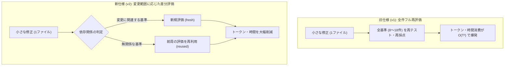
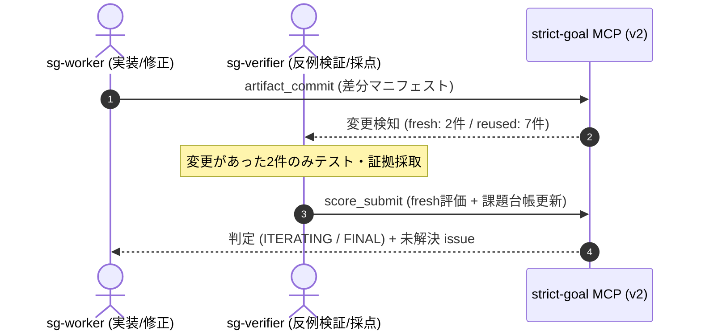

# strict-goal ラウンド削減設計（v2）の全体像

## 1. 解決した根本課題（なぜ必要だったか）

従来（v1）の strict-goal には、**「わずか1行直しただけでも、全基準をゼロから評価し直す」** という構造的ボトルネックがありました。

また、「前回指摘された課題が本当に直ったのか」が曖昧で、修正漏れによる無駄な再試行（ラウンド浪費）や API 枠切れが発生していました。

---

## 2. 3大コアメカニズム

今回の設計改訂（[`design-strict-goal-round-reduction.md`](file:///D:/vagrant/harnesses/rubric-loop-mcp/docs/design-strict-goal-round-reduction.md)）は、以下の3つの柱で成り立っています。

### ① 変更差分に応じた評価再利用（Rebase & Cache）
- **仕組み**: 成果物（fileset や設計ドキュメント）のコミット内容から変更パス・差分を抽出。
- **動作**: 
  - 変更に関係のない基準は、前周のスコア・エビデンスを自動で **`reused`**（再利用）として持ち越し。
  - 変更に影響された基準のみ **`fresh`**（新規検証）を要求。
- **効果**: 周回ごとのテスト実行回数とコンテキスト消費が激減。

### ② 不変の課題台帳（Issue Ledger）
- **仕組み**: 減点対象となった課題や `must_fix` に一意の `issue_id`（例: `iss_abc123`）を発行し、追記型ログで管理。
- **動作**:
  - 課題が残っている基準は 9 点以上になれない。
  - 「修正された証拠（command evidence 等）」が提示されて初めて課題が `resolved` に遷移。
- **効果**: 「直したつもりで点数を上げる」「直していないのに見落とされる」手戻りを完全防止。

### ③ 採点提出前の事前検査（Runtime Preflight & Anti-Gaming）
- **仕組み**: 
  - 稼働中の MCP サーバーがローカルリポジトリの実体と一致しているかをダイジェストで事前照合。
  - 不正加点防止（成果物が変わっていないのに加点する `E_SCORE_INFLATION` や、前周と同じ証拠を使い回す `E_EVIDENCE_STALE`）を即座にガード。
- **効果**: サーバー側での不正リジェクトによる無駄なラウンド消費を未然に遮断。

---

## 3. ラウンド進行の変化

---

## 4. 主なメリットまとめ

| 観点 | 従来 (v1) | 新設計 (v2) |
|---|---|---|
| **再評価範囲** | 毎周全件（8〜18基準）を再実行 | 変更箇所が影響する基準のみ新規実行 |
| **課題追跡** | 文字列の must_fix のみ（手戻り多） | `issue_id` による厳密なライフサイクル管理 |
| **トークン消費** | ラウンドごとに $\mathcal{O}(T^2)$ で急増 | 差分のみで有界（$\mathcal{O}(T)$ 近くに圧縮） |
| **安全性** | 実行環境の不一致を検知できない | Preflight により偽陽性・誤判定を即排除 |

---

## 5. 関連ファイル
- **設計仕様書**: [`docs/design-strict-goal-round-reduction.md`](file:///D:/vagrant/harnesses/rubric-loop-mcp/docs/design-strict-goal-round-reduction.md)
- **タスク計画書**: [`docs/plans/strict-goal-round-reduction-plan.json`](file:///D:/vagrant/harnesses/rubric-loop-mcp/docs/plans/strict-goal-round-reduction-plan.json)
- **移行手順書**: [`docs/strict-goal-round-reduction-migration.md`](file:///D:/vagrant/harnesses/rubric-loop-mcp/docs/strict-goal-round-reduction-migration.md)
