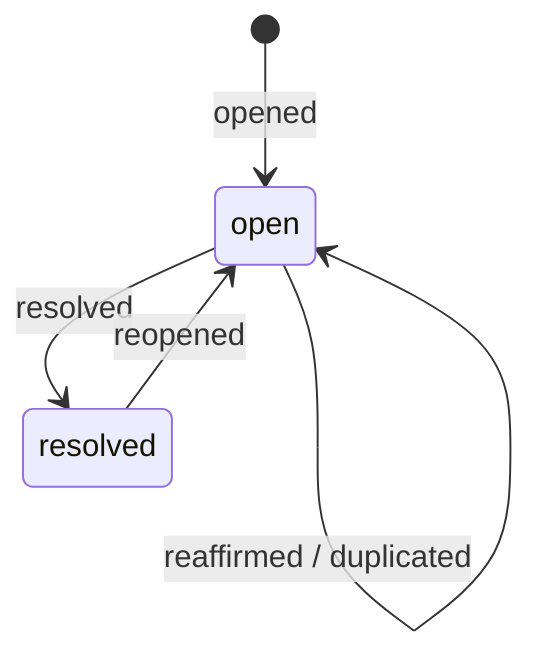

<!-- spec-doc:last-reviewed-commit=49126cac93b51c783d715da3ce4836a4efaee549 reviewed-at=2026-10-18 -->

# 仕様書

## 1. 概要・システムアーキテクチャ

`strict-goal` は、LLM（AIコーディングエージェント）の自己評価バイアス、スコアインフレ、評価基準の忘却、および早期完了宣言（サボり）を構造的に排除し、客観的なルーブリック検証を満たすまでゴール完遂を強制する Model Context Protocol (MCP) サーバーおよびハーネスシステムである。

- **仕様準拠**:
  - Model Context Protocol (MCP) 2026-07-28（ステートレス改訂）および 2025-11-25
  - Agent Plugins 1.0.0 仕様（可搬プラグインマニフェスト `plugin.json`、ツールプロバイダー `mcp.json` / `mcp.http.json`）
- **通信モード**:
  - `stdio`（標準入出力 JSON-RPC 2.0、クライアント統合用）
  - `streamable-http`（HTTP デーモンモード、`http://127.0.0.1:<port>/mcp`）
- **CLI 起動オプション** (`node strict-goal/server/main.js`):
  - 既定は `stdio` で起動する。
  - `--http` を付けると HTTP サーバとして起動する。
  - `--port <n>`（既定 `8971`）と `--host <addr>`（既定 `127.0.0.1`）で待受先を変える。
  - 待受開始時、サーバは `strict-goal HTTP server listening on http://<host>:<port>/mcp` を標準エラーへ出す。
  - `--data-dir <dir>` でデータ保存先を直接指定する。
- **ランタイム要件**:
  - Node.js >= 20.0.0（CI自動検証: Node.js 24.x）
  - 外部依存ゼロ（`node:fs`, `node:crypto`, `node:http` 等の標準組込モジュールのみで稼働）

---

## 2. パイプラインとセッション連鎖 (Chained Loop Modes)

ソフトウェア開発の各工程に対応する3つのセッションモード（`loop_mode`）を提供し、上流の確定成果物ダイジェスト（SHA-256）を暗号学的に固定（ピン留め）して連鎖する。

```
[ 要求・課題 ]
      │
      ▼
┌───────────┐     成果物ダイジェストピン留め (sha256)
│  design   │ ─────────────────────────────────┐
└───────────┘                                  │
  設計書・仕様書 (Markdown)                     ▼
                                        ┌───────────┐     成果物ダイジェストピン留め (sha256)
                                        │   plan    │ ─────────────────────────────────┐
                                        └───────────┘                                  │
                                          タスク依存DAG・計画 (JSON)                   ▼
                                                                                ┌───────────┐
                                                                                │ implement │
                                                                                └───────────┘
                                                                                  複数コード/テスト (fileset)
                                                                                  テストインベントリ・ミューテーション
```

| モード (`loop_mode`) | 成果物種別 (`artifact_kind`) | 成果物形式と制約 | 上流要件 |
|---|---|---|---|
| `design` | `markdown` | アーキテクチャ・仕様書本文（Markdown 文字列または `source_path` によるワークスペース内ファイル参照） | 不要（最上流） |
| `plan` | `plan` (JSON) | タスクDAG、`summary` (>=40文字)、`tasks[]`、`design_refs` を含む厳格な JSON（文字列または `source_path`） | `FINAL` 確定した `design` セッションの `upstream_digest` |
| `implement` | `fileset` (multi-file) | 各ファイルパスと sha256 からなるマニフェスト、`test_inventory` (テスト実行結果・カウント) | `FINAL` 確定した `plan` セッションの `upstream_digest` |

### 2.1 上流連鎖保護 (Lineage Protection) とチェーン予算管理
1. **失効 (`SUPERSEDED`)**:
   - 上流セッションの確定成果物が変更（改変）された場合、下流セッションは直ちに `SUPERSEDED` 状態へ遷移し、追加のコミットや採点は拒絶（`E_SUPERSEDED`）される。
2. **リベース (`rebase`)**:
   - `escalate(action: "rebase")` により、改定された上流との差分を自動検査し、影響を受けた評価基準のみを特定して再採点対象とし、状態を `DRAFTING` へ復帰させる。
   - v1 セッションでは、`upstream` 根拠の抜粋が新しい上流本文に残る基準を引き継ぐ。
   - v2 セッション（§3.3）では、サーバが新旧の上流成果物から変更キーを導出する。
     - `plan` 上流はタスク ID 単位（`upstream:<id>`）、`fileset` 上流はファイルパス単位（`artifact:<path>`）で比較する。
     - タスク・ファイル以外の部分が変わった場合、または差分を導出できない場合は「不明」とみなす。
   - v2 で基準を引き継ぐ条件は次のとおり。1つでも欠けると、その基準を再採点対象にする（fail-closed）。
     - 前周の採点に `dependency_declaration` と `context_key` がある。
     - 宣言した依存キーがすべて既知のキーである。
     - 依存キーが変更キーに含まれない。
     - `upstream` 根拠の抜粋が新しい上流本文に残っている。
   - `criterion_dependency_graph`（依存元 → 依存先の基準 ID）があれば、無効化を依存先の基準へ伝播する。
   - v2 のリベース結果は `session.verified_reuse`（新しい上流ダイジェストと引継ぎ基準 ID）に残る。次の `score_submit` がこれを参照し、消去する。
3. **差し戻し (`kickback`)**:
   - 実装中に上流仕様の欠陥を発見した場合、`escalate(action: "kickback")` を提起する。下流セッションは `FROZEN` 状態（`E_FROZEN`）で凍結され、上流セッションの再改定を行う。実行前に request_human(approval_action:"kickback", target_criteria) でチャット承認を求め、確認IDと返答原文を受け取る。
   - 上流が再び `FINAL` になったとき、ダイジェストがピンと異なれば下流は `SUPERSEDED` へ移り、`rebase` で再開する。
   - ダイジェストがピンと同じ（上流を元に戻した）場合、乗せ直す差分が無いため、下流は次のツール呼出し時に `DRAFTING` へ自動復帰する。`session.thawed` に `reason: "upstream_final_unchanged"` の記録が残る。
4. **チェーンラウンド予算管理 (`chain round budget`)**:
   - チェーン全体の累積ラウンド数（`computeChainRounds`）を `score_submit` 時に自動検査。
   - 予算超過時:
     - 採点合格（`verdict === "FINAL"` / `"FINAL_WITH_RELAXATION"`）の場合: `FINAL` を維持し、`warnings: ["chain_budget_exceeded"]` を付与。
     - 採点不合格（`verdict !== "FINAL"`）の場合: `verdict: "REVISE"`, `state: "ESCALATED"` へ自動遷移し、エスカレーション情報（`detail: { reason: "chain_budget_exhausted", ... }`）とチャット承認用の確認IDと next_action を発行。追加の request_human は不要。
     - 累積ラウンド数が実効上限（基本予算 + 付与済み追加枠）を超えた不合格提出は `E_CHAIN_BUDGET_EXHAUSTED` で拒否する。
     - 追加枠を使い切って再び上限に達した場合も、サーバは採点を保存して `ESCALATED` へ遷移し、新しい確認IDを発行する。
   - `escalate(action: "resolve", resolution: "continue")` により、セッションに +3周、チェーン予算超過時はチェーン全体にも追加ラウンド枠（既定 +6周）が付与（`grantExtraRounds`）され、状態が `DRAFTING` へ復帰。
   - 追加枠は承認ごとに累積加算する（回数制限なし）。各付与は `extra_rounds_granted` イベントとしてチェーン監査に残る。
   - 消費済みの確認IDの再利用と、同一要求の再送による二重加算は拒否する。

### 2.1.1 上流セッションの自動解決 (`loop_open`)
- `upstream` は `session_id` だけで指定できる。`artifact_digest` を省略すると、サーバが上流セッションの現在の成果物ダイジェストで補う。
- `loop_mode: "implement"` で `upstream` を省略すると、サーバが `index.json` から `FINAL` / `FINAL_WITH_RELAXATION` の `plan` セッションを探す。
  - 候補が複数ある場合、`updated_at`（無ければ `created_at`）が最新のものを選ぶ。
  - 候補が無い場合は `E_UPSTREAM_REQUIRED` を返す。
- `loop_mode: "plan"` で `upstream` を省略すると `E_UPSTREAM_REQUIRED` を返す（自動解決しない）。
- 補完・自動解決後のピンは、従来どおり4項目の上流検査（`validatePin`）を通す。

### 2.2 fileset の証跡照合仕様
- **マニフェスト照合**: サーバはワークスペースの実ファイルを直接走査しない（設計原則 A3: クライアント完全隔離）ため、`readArtifactContent` が返す成果物本文はマニフェスト JSON テキスト（`sha256-<digest>.manifest.json`）となる。
- **locator 根拠の照合順序**:
  1. サーバは `excerpt` をマニフェスト JSON テキストと照合する。
  2. 一致しない場合、マニフェストの各 `path` をワークスペース根から読み、個別ファイル本文と照合する。
  - ワークスペース根は、データ保存先が `<workspace>/.strict-goal` ならその親、それ以外はデータ保存先自身とする。
  - 読み込めないファイルは照合対象から外す。
- **抜粋照合の揺れ吸収 (`matchesExcerpt`)**: `locator` / `upstream` 根拠の照合は、NFC 正規化・改行統一・行末空白除去の後に部分一致を見る。一致しない場合、連続する空白・改行を1個の空白に畳んで再照合する。
- **v2 強制ステージの厳密照合**: v2 強制ステージ（§3.3）では、採点前の事前検証で `locator` の `excerpt` がコミット時の保存バイトにそのまま含まれることを要求する。揺れ吸収と個別ファイル照合は適用しない。不一致は `E_EVIDENCE_EXCERPT_MISMATCH` で拒否する。
- **実行・テスト根拠**: 個別ファイルのコード実装やテスト結果の正当性は、`kind: "command"` 根拠（終了コード 0、標準出力ハッシュ、`target_digest`）によって証明する。

---

## 3. FSM (有限状態機械) とガードレール

セッションは厳格な状態遷移を持ち、モデルが勝手に完了を宣言することはできない。判定（verdict）を発行する権威はサーバー側のみに存在する。

### 3.1 状態一覧
- `INIT`: セッション開設直後（`loop_open` 実行完了時）。
- `DRAFTING` / `ARTIFACT_PENDING`: 成果物の執筆・改訂待ち。
- `SCORING`: 成果物コミット完了後、全基準に対する自己採点の提出待ち。
- `EVALUATED`: サーバー判定完了後、次周（`ITERATING`）への移行、または合格（`FINAL`）。
- `FINAL` / `FINAL_WITH_RELAXATION`: 合格基準（加重平均 >= 9.0、全基準最低点 >= 9）を満たし完了確定。
- `STALLED`: 連続停滞（スコア改善なしが規定周回継続）または `max_rounds` 到達による打ち切り。
- `ESCALATED`: 人間への支援要請、緩和承認待ち、チェーン予算枯渇（`chain_budget_exhausted`）、上流リベース、キックバック待ち。
- `SUPERSEDED` / `FROZEN`: 上流の成果物不整合による無効化・凍結。

### 3.2 アンチゲーミング・ガードレール仕様
1. **スコアインフレ検知 (`E_SCORE_INFLATION`)**:
   - 成果物の本文・マニフェストが前回と不変（`artifact_unchanged`）であるにもかかわらず、スコアを上げた提出を拒否。
2. **根拠の使い回し検知 (`E_EVIDENCE_STALE`)**:
   - 前周と完全に同一の根拠（`evidence_digest`）のままスコアを引き上げる提出を拒否。
3. **スコア急上昇検知 (`E_SCORE_JUMP`)**:
   - 1周で設定値（既定: 3点）を超える大幅な加点を行う場合、終了コード 0 の `command` 根拠が2件以上添付されていない限り拒否。
4. **理由・弱点申告の義務付け**:
   - 全基準について 40 文字以上の論理的理由（`rationale`）と弱点（`weakness`）を要求。満点（10点）以外での `'none'` 申告は `E_WEAKNESS_REQUIRED` で拒絶。
5. **停滞検知 (Stall Detection)**:
   - スコア改善幅が閾値（0.25）未満の周回が連続規定回数（`design`: 3回、`plan`: 2回）に達した、あるいは `max_rounds` に到達した場合、自動的に `STALLED` へ落とし進行を阻止。
6. **テスト後退検知 (`E_TEST_REGRESSION`, `E_TEST_NOT_GREEN`)**:
   - 前周に存在したテスト名の理由なき削除、テスト skip 数の増加を検知して拒否。テストが失敗（赤）している状態での合格点申告を拒絶。
7. **破壊的上書き検知 (`warnings: ["destructive_overwrite"]`)**:
   - 直前成果物の10倍以上あった内容が急激に 200 バイト未満へ縮小し、かつ変更率 90% 以上の極小コミットを検出して警告を発行。
8. **スコープガード検知 (`warnings: ["out_of_scope_section"]`, `["appendix_accretion"]`)**:
   - `rubric.policy.scope_guard_terms` に登録された禁止用語を含む節見出しの混入や、末尾付録の肥大化パターンを検出して警告。
9. **逃避的弱点表現排除 (`E_WEAKNESS_EVASIVE`)**:
   - 「特になし」「問題なし」「十分である」「将来検討」「スコープ外」等の自己満足・逃避的表現を正規表現で検知し、採点提出を即時拒絶。
10. **優先度付き must_fix ソート (`criterion.priority`)**:
    - ルーブリック基準の `priority` (0〜3) 降順、スコア昇順でソートし、重要基準の修正課題を最優先（上位3件）でエージェントへ提示。
11. **初回提出課題義務付け (`policy.min_first_round_must_fix`)**:
    - Round 1 では最低指定件数（既定 1〜2件）の `pass_score` 未満（must_fix）の申告を義務付け、満たさない場合は `E_FIRST_ROUND_UNCRITICAL` で拒否。
12. **採点の事前検証と拒否記録 (`score_submit`)**:
    - サーバは採点処理の前に、入力スキーマ・根拠の形・`artifact_digest` の一致を検査する。
    - 保存済み成果物の本文ダイジェストが記録と食い違う場合は `E_COMMITTED_DIGEST_MISMATCH` で拒否する（fileset は対象外）。
    - 事前検証の失敗は `rounds/<round>.rejected/<seq>.json` に `event_type: "rejected_prevalidation"` として残る。
    - 拒否記録は `submission_id` と入力全体のダイジェスト（`payload_digest`）を持つ。同じ組の再送では記録を増やさない。
    - 過去に拒否された同じ `submission_id`・同じ入力の再送には、前回と同じエラーコードを返す。

### 3.3 v2 評価ポリシー（ラウンド削減）と課題台帳
v2 評価ポリシーは、条件変化と品質改善を区別し、未解決課題を台帳で追跡する仕組みである。ラウンドとトークンの削減を目的とする。移行手順の詳細は [strict-goal-round-reduction-migration.md](strict-goal-round-reduction-migration.md) にある。

#### ステージとセッションへの固定
- 環境変数 `STRICT_GOAL_ROUND_REDUCTION_STAGE` が新規セッションのステージを決める。既定は `v1`。
- ステージは `v1` / `observe-only` / `dual-read` / `enforce-new-session` / `default-on` の5種類。未知の値は `E_SESSION_POLICY_INVALID` になる。
- `loop_open(create)` は `session.json` の `evaluation_policy`（`schema_version`, `policy_version`, `stage`）にステージを固定する。
  - `v1` は `schema_version: 1`、それ以外は `schema_version: 2` になる。
- 再開・reopen・kickback は作成時のポリシーを保つ。環境変数の変更は新規セッションだけに効く。
- `evaluation_policy` を持たない旧セッションは、読み込み時に v1 として扱う。ファイルは書き換えない。
- 固定値の組み合わせが矛盾するセッションは `E_SESSION_POLICY_INVALID` で読み込みを拒否する。
- サーバはステージを自動で進めない。

| ステージ | 挙動 |
|---|---|
| `v1` | 従来の採点・完了判定のみ。 |
| `observe-only` | v2 の評価コンテキストと課題台帳を記録する。完了判定は v1 のまま。 |
| `dual-read` | `observe-only` に加え、v2 で拒否される提出を `warnings`（`v2_` 接頭辞）で知らせる。 |
| `enforce-new-session` / `default-on` | v2 の要件を強制する（以下「v2 強制ステージ」）。 |

#### 評価コンテキスト (`evaluation_context`)
- `score_submit` は任意入力 `evaluation_context.snapshot` を受け取る。5種のダイジェスト（`artifact_digest`, `scope_digest`, `rubric_digest`, `environment_digest`, `test_selection_digest`）を持つ。
- v1 セッションへの `evaluation_context` または `dependency_declaration` の送信は `E_SESSION_POLICY_INVALID` で拒否する。
- v2 強制ステージでは5種すべてが必須である。`artifact_digest` と `rubric_digest` はセッションの値と一致しなければならない。違反は `E_EVALUATION_CONTEXT_INVALID` になる。
- `dual-read` で `evaluation_context` が無い場合、`warnings` に `v2_context_required` が付く。
- 受理したスナップショットは `evaluation-context.json` にハッシュ連鎖付きで追記する。
- v2 の非強制ステージで `evaluation_context` が無い場合、サーバは成果物・ルーブリックのダイジェストだけを記録する。残りは `unknown_fields` として残す。

#### 条件変化の承認束縛
- サーバは前回のスナップショットと比べ、スコープ・ルーブリック・環境・テスト選択のダイジェスト変化を検出する。
- 変化がある場合、`evaluation_context.condition_changes[]` に同じ `reason`・変更前後のダイジェスト・`approval_id` が必要である。
- `approval_id` は、`approval-bindings.jsonl` 内の未消費・期限内の承認束縛1件と一致しなければならない。
- 違反時のエラーは次のとおり。

| 変化 | エラー |
|---|---|
| `scope_change` | `E_SCOPE_APPROVAL_REQUIRED` |
| `rubric_change` | `E_RUBRIC_APPROVAL_REQUIRED` |
| `environment_change` | `E_ENVIRONMENT_APPROVAL_REQUIRED` |
| `test_selection_change` | `E_TEST_SELECTION_CHANGED` |

- v2 強制ステージ以外では、これらは拒否にならない。`dual-read` だけ `warnings` に出す。
- 採点を受理すると、使った承認束縛を消費済みとして追記する。
- 承認束縛を作る MCP ツール経路は現時点で無い（`recordApprovalBinding` はサーバ内部関数）。（要確認: 承認束縛の作成手段）

#### 品質差分 (`quality_delta`)
- 受理した採点の記録と応答は `quality_delta` を持つ。
  - `artifact_improved`: 条件変化が無く、加重平均が前周より上がった場合に `true`。
  - `condition_changed`: 承認済みの条件変化を含む場合に `true`。

#### 合格未満スコアの束縛
- v2 強制ステージでは、`pass_score` 未満の基準に次の3点を要求する。欠けると `E_ISSUE_BINDING_REQUIRED` で拒否する。
  - `locator` と `excerpt` が空でない `locator` 根拠（アンカー）
  - 1件以上の根拠
  - `none` 以外の `weakness`（解消条件）
- `dual-read` ではこの違反を `warnings` に出すだけにする。

#### 依存宣言と評価の再利用
- 各採点は任意の `dependency_declaration` を持てる。宣言は成果物パス・上流契約 ID・スコープ・ルーブリック条項・根拠種別・検証環境キーの6配列からなる。
- 成果物パスと上流契約 ID が両方空の宣言は無効として扱う。
- v2 強制ステージでは、サーバが基準ごとに `context_key` を算出する。入力は基準 ID・ルーブリック・依存値・環境・根拠集合のダイジェストである。
- 次の条件をすべて満たす基準は `evaluation_basis: "reused"` になる。それ以外は `"fresh"` になる。
  - 前周に合格し、`context_key` とスコアが前周と同じ。
  - 直前のリベースがその基準を引継ぎ対象にした（`verified_reuse`）。
  - `locator` 根拠を含む。
- 全基準が `reused` のまま `FINAL` になる場合、サーバは全基準を `fresh` に戻す。

#### 課題台帳 (`issue-ledger.jsonl`)
- v2 セッション（`schema_version: 2`）では、不合格の基準ごとに課題 `ISS-score-<criterion_id>` を台帳へ追記する。
- 各イベントは連番と前イベントのハッシュを持つ（追記専用のハッシュ連鎖）。
- 不正な遷移は `E_ISSUE_STATE_INVALID` で拒否する。



- 応答の `issue_summary` は未解決の blocking 課題を最大3件 `must_fix` に並べる。
  - 並び順は重大度の降順、影響基準数の降順、初出の古い順。
  - `unresolved_count`、表示外の件数、`ledger_ref`（パス・イベント数・先頭ハッシュ）も返す。
- v2 強制ステージでは、未解決の blocking 課題が残る間は `FINAL` を出さない（`E_ISSUE_STATE_INVALID`）。`dual-read` では `warnings` に出す。

#### ラウンド計測
- v2 セッションの受理記録は `metrics` を持つ。フェーズ・周回・スナップショットダイジェスト・fresh/reused 件数・無効化理由・課題イベント・トークン・時間内訳を含む。
- 観測できない値は `unknown` とする。0 や推定値で埋めない。

#### サーバ経路に未接続の部品
次の部品はモジュールとテストだけがあり、MCP ツールからは呼ばれない。（要確認: 接続予定の有無）
- `evaluation/contracts.js`: `IssueRecord` / `CriterionEvaluation` / `ChangeReason` の契約検査（`E_EVALUATION_CONTRACT`）。スキーマは `schemas/evaluation-v2.json`。
- `runtime/preflight.js`: 実行中のソースがリポジトリ内の期待ファイルと実パスで一致するかの検査（`E_RUNTIME_PREFLIGHT`）。
- `metrics/round_reduction.js` の `evaluateReleaseGate` と `rollout/readiness.js`: A/B 比較（介入 A〜D）とテスト件数から `ready` / `hold` を返す報告。ステージやポリシーは変更しない。
- `judge/round_store.js` のページング（`pageRejectedSubmissions` / `pageUnresolvedIssues`）: `limit` 1〜100 とカーソルによる一覧取得。

---

## 4. 提供ツール仕様 (8 Orthogonal MCP Tools)

| ツール名 | 機能・役割 | 主な入力引数 (`inputSchema`) | 主な出力 |
|---|---|---|---|
| `loop_open` | セッションの新規開設（`mode: "create"`）または既存セッションの再開（`mode: "resume"`） | `mode`, `loop_mode`, `task`, `rubric_preset`, `upstream`, `label`, `workspace_dir`, `allow_ephemeral` | `session_id`, `state`, `round`, `next_action`, `rubric` |
| `loop_state` | 現在の状態、周回番号、アクティブな基準、履歴、または有界射影の取得 | `session_id`, `include` (`["rubric", "history", "upstream", "chain"]`), `projection` (`"skill_state"`) | `state`, `round`, `next_action`, `last_evaluation`, `skillState` |
| `artifact_commit` | 成果物（Markdown文字列、JSON、ファイルパス参照、またはfilesetマニフェスト）のコミット | `session_id`, `expected_round`, `change_note`, `content` または `source_path` または `files`, `addresses`, `test_inventory` | `state`, `artifact_digest`, `diff`, `warnings`, `next_action: "score_submit"` |
| `score_submit` | ルーブリック全基準に対する採点・理由・弱点・エビデンスの提出 | `session_id`, `expected_round`, `artifact_digest`, `scores` (`[{ criterion_id, score, rationale, weakness, evidence, dependency_declaration? }]`), `evaluation_context?` | `verdict` (`ITERATING` / `FINAL` / `REVISE`), `weighted_mean`, `min_score`, `must_fix`, `quality_delta`, `issue_summary`（v2）, `next_action`, `escalation`, `warnings` |
| `rubric_amend` | 基準や閾値の変更（40文字以上の理由と緩和ログ記録） | `session_id`, `reason`, `amendments` (`add`, `modify`, `remove`) | `state`, `rubric_version`, `rubric_diff`, `is_final_reachable` |
| `escalate` | 人間への支援要請、上流リベース、キックバック、セッション再開 | `session_id`, `action`（`request_human` / `resolve` / `abort` / `reopen` / `rebase` / `kickback`）; `request_human` は `approval_channel: "chat"` と `approval_action`（`resolve` / `kickback` / `reopen`）。全ての承認は `escalation_id`, `human_reply`。resolveは `resolution`、kickbackは `target_criteria` を指定し、reopenは目的付き確認を使う | `state`, `escalation_id`, `resolution`, `chain` |
| `audit_export` | 改ざん検知可能な監査 JSON（セッション単位またはチェーン全体）の出力 | `session_id`, `scope` (`session` / `chain`), `include_artifacts`, `include_rejected`, `include_diffs` | `export` (`path`, `sha256`, `schema`) |
| `invoke_subagent` | 孤立した子セッションでエフェメラルなサブエージェントを実行し結果を取得 | `prompt`, `agent_type`, `runner` (`"auto"` / `"agy"` / `"claude"` / `"codex"`), `workspace_dir`, `timeout_sec` | `ok`, `output`, `conversation_id`, `subagent_session_id`, `exit_code`, `duration_ms` |

STALLED時の標準承認はチャットでの明示的な返答を待ち、確認ID・返答原文・判断を記録する方式とする（[手順・互換性](chat-approval.md)）。

`kickback` も `escalation_id` と `human_reply` で承認できる。`request_human` に `target_criteria` を渡すと差し戻し専用の確認を作り、同じ対象基準と明示的な返答で実行する。差し戻し用のチャット承認要求に限り `FINAL` / `FINAL_WITH_RELAXATION` からも受け付ける。

- **承認経路の統一**: 全ての承認（STALLED の resolve、自動 `ESCALATED`、kickback、reopen）は確認IDと返答原文で行う。
  - 旧トークン方式は廃止した。エラーコード `E_TOKEN_INVALID` も削除した。廃止パラメータは入力検証で拒否する。
  - 旧サーバが作った保留中の承認記録も、確認IDとチャット返答で処理できる。消費時に現在の監査形式へ正規化する。
  - `approval_action` を省略した場合、`target_criteria` があれば `kickback`、無ければ `resolve` として扱う。
- **事前検査の順序**: kickback は確認を消費する前に前提条件を検査する（`prepareKickback`）。前提条件エラーでは確認は保留のまま残る。
- **承認待ちの復元**: 承認待ちのセッションでは、`score_submit` の応答・`loop_state`・`loop_open(resume)` が保留中の `next_action`（確認ID付きの `escalate` 呼出し雛形）を返す。

- **入力の許容と自動整理**:
  - `score_submit`: `weakness` の `"None"` / `"none."` / `"N/A"` / `"NA"` / 空文字は `"none"` に正規化する。正規化後も `"none"` は満点（10点）のときだけ受理する。
  - `rubric_amend`: `reason` が無く `change_note` がある場合、`change_note` を `reason` として扱う。
  - `rubric_amend`: 基準を削除すると、`last_evaluation.must_fix` から削除済み基準の項目を除く。
  - `artifact_commit`（`plan`）: 本文全体が ` ```json ... ``` ` のコードフェンスで囲まれている場合、フェンスを外して JSON として解析する。

- **監査スキーマ識別子 (URN)**:
  - 単体セッション監査: `urn:strict-goal:schema:audit:v1`
  - 連鎖監査: `urn:strict-goal:schema:audit-chain:v1`
  - 同梱の `strict-goal/server/verify_audit.js` により、オフラインで監査ログの完全性・再計算検証が可能。
- **スケルトン自動充填 (`next_action.input_skeleton`)**:
  - `score_submit` や `artifact_commit` 等のレスポンスには、そのまま埋めて送信可能な `input_skeleton` が事前充填される。全エビデンス形式（`locator`, `command`, `upstream`）の具体例と必須条件が示され、クライアント/エージェントがサーバ内部ソースを探索して `E_VALIDATION` を繰り返す手戻りを防止。
  - `score_submit` 用の雛形は、ルーブリックの全基準を1件ずつ `scores[]` に展開する。`auto` 基準には `command` と `locator`、`manual` 基準には `locator` の根拠雛形を入れる。

### 4.1 静的 HTML ダッシュボード自動生成 (`persistSession`)
セッション状態を変更する全操作の実行時、`src/store/persist.js` 経由でダッシュボードが自動再生成される。
- `<data_dir>/dashboard/<session_id>.html`: セッション詳細ダッシュボード（状態、周回、ルーブリック採点状況、must_fix、評価推移）。
- `<data_dir>/dashboard/index.html`: 全セッション一覧ダッシュボード（チェーンID、モード、最終判定、タイムスタンプ）。
- 各ダッシュボード HTML には `<meta http-equiv="refresh" content="5">` が付与され、外部ブラウザでのリアルタイム（5秒周期）自動更新に対応。

### 4.2 コンテキスト有界射影 (Skill State Projection) と試行履歴
`loop_state(projection: "skill_state")` により、過去ログ全体を読み戻すことなく、次の有界三つ組 $(P, \Sigma_t, O_t)$ のみを取得可能。
- **不変仕様 $P$ (`immutable_spec`)**: `task`, `loop_mode`, `criteria_summary`, `allowed_tools`
- **カノニカル状態 $\Sigma_t$ (`canonical_state`)**: `session_id`, `round`, `state`, `must_fix`, `trial_history`, `counters`, `policy`
- **最新観測 $O_t$ (`recent_observation`)**: コミット受信（`commit_ack`）または評価結果判定（`eval_verdict`）の要約
- **課題台帳の反映**: 課題台帳にイベントがある場合、`canonical_state.must_fix` は台帳の未解決課題（最大3件）になる。`unresolved_count`、`undisplayed_issue_ids`、`ledger_ref` も加わる。
- **承認待ちの反映**: 保留中の承認がある場合、`recent_observation` は承認待ちの要約と保留中の `next_action` を持つ。
- **試行履歴 (`trial_history.json`)**: セッション中に訪問したファイル（`visited_files`）および棄却された仮説（`failed_hypotheses`）を記録し、エージェントの堂々巡り探索を防止。

### 4.3 動的ワークスペースルーティングとセッションレジストリ
- `loop_open` の `workspace_dir` パラメータに基づき、対象ワークスペース直下の `.strict-goal/` をデータ保存先として動的に解決。
- `session_registry.js` により、セッションID・チェーンID・上流セッションIDから保存先ディレクトリを自動ディスパッチ。MCP サーバープロセスが複数プロジェクト間で再利用される場合でも、セッションの誤混入や他プロジェクト汚染を完全に防止。
- `workspace_dir` 未指定時は、カレントディレクトリから `.git` を持つプロジェクトルートを探索してフォールバック。

---

## 5. 人間向けインターフェース・スキル・補助CLI

AIエージェントおよび人間の開発者が自律的かつ自然言語で開発ループを円滑に回し、客観的検証と周回管理を遂行するためのインターフェース層と補助ツール群を提供する。

### 5.1 コマンド・人語連携スキル
- **スラッシュコマンド・フェーズショートカット**:
  - `/strict-goal <指示>`: 厳格モードで指定ゴールを実行（ホスト標準 `/goal` との競合を解消）。
  - `strict-goal <指示>`: CLI プレフィックスによる連鎖パイプライン起動。
  - `strict-goal [design|plan|implement] <target>`: フェーズ明示起動。
- **自然言語トリガー**:
  - 「`strict-goalで` 〇〇を実装して」「`厳格モードで` 〇〇して」「`サボらずに` 〇〇して」などの人語指示を検知し自動起動。
- **トークン消費量集計スキル**:
  - `session-tokens`: セッションおよび起動された全サブエージェントのトークン消費（キャッシュ入力・非キャッシュ入力・出力・合計）を精密集計。配置先ごとに実装が異なる。
    - `.claude/skills/session-tokens`: Claude Code のセッション jsonl とサブエージェント jsonl を集計する。サブエージェントの種別は `meta.json` の `agentType` をラベルに使う。
    - `.agents/skills/session-tokens`: Antigravity (AGY) の sqlite/protobuf 記録を集計する。
  - `codex-session-tokens`: Codex セッションのトークン消費を集計。子 rollout に親履歴由来の `session_meta` が後続で含まれていても、最初に出現した `session_meta` をその rollout 自身の識別子として扱う。

### 5.2 階層型サブエージェント体系とライフサイクル委譲規約
親エージェントのコンテキスト肥大化とトークン消費（$\mathcal{O}(T^2)$ 爆発）を防ぐため、6種類の役割特化型サブエージェントを標準提供。正本は `strict-goal/agents/` にあり、`.claude/agents/`・`.agents/agents/`・`.codex/agents/*.toml` へ配布する。

- **エージェント定義**:
  - `sg-designer`: 設計フェーズ監督。`loop_open(design)` から `FINAL` までの周回を統括する。
    - 執筆・修正はまず `helper.js design-draft` / `design-fix`（§5.3）で外部 CLI に任せる。終了コード 2（`NO_CONFIG`）なら自分で執筆する。
    - `design-fix` には `-` を指定し、must_fix を heredoc で標準入力から渡す。
    - 採点は `sg-verifier` に委譲する。
    - 設計フェーズの完了で止まり、`plan` / `implement` へ自動で進まない。
  - `sg-implementer`: 実装フェーズ監督。`plan` のタスクDAGを解析し、`sg-worker` への順次委譲とテスト検証・周回提出を統括。
  - `sg-worker`: 単一タスク / must_fix 修正担当。strict-goal ツールを持たず、コード編集と単体テスト通過のみを行う極小コンテキスト作業者。
  - `sg-coder`: 単体自律実装。中規模タスクを単一サブエージェントで自律周回完遂。
  - `sg-scout`: コードベース探索・事実収集。ステートレスに事実のみを報告し親のコンテキストを節約。
  - `sg-verifier`: テスト実行・客観検証・採点提出担当。エビデンス収集と `score_submit` を専任実行。
    - 設計レビューでは3種の反例プローブ（`time_state_trace`, `policy_trace`, `complexity_trace`）を行う。
    - ラウンド2以降に `.strict-goal/evidence/<session>/<round>/impact.json` があれば、記載の `checks` を `helper.js design-check` で検証する。無ければこの検証を省く。
    - 採点前に、課題・スコープ・ルーブリック等の有界プローブで v2 の束縛（§3.3）を確認する。
- **承認の受け渡し**: サブエージェントは確認ID・理由・提案操作を親へ返す。ユーザーへのチャット確認は親が行う。
- **Codex 向けの state-only 委譲**: `spawn_agent` が使える環境（Codex）だけに適用する規約である。
  - 子は `spawn_agent(..., fork_turns="none")` で起動し、親の会話履歴を引き継がせない。履歴なしで起動できない場合は黙って継承せず、非互換として報告する。
  - 子へのメッセージは `{ skill_state, transaction, paths, output_contract }` だけにする。成果物全文・会話記録・テスト出力は埋め込まない。
  - トランザクションごとに新しい子を起動し、前の子を再利用しない。
  - 記載先は `.agents/skills/strict-goal/SKILL.md`、`.codex/skills/strict-goal/SKILL.md`、`.codex/agents/sg-implementer.toml`。`.claude/` と `.agents/` の `sg-implementer.md` には書かない。
- **SKILL.state & ライフサイクル委譲規約（親の直接作業厳禁）**:
  - **直接作業の禁止**: 親エージェントは自己採点、エビデンス抽出、ハッシュ計算、テスト試行錯誤を直接行わず、執筆・修正を `sg-worker`、検証・採点を `sg-verifier` に全フェーズ（`design`, `plan`, `implement`）で委譲する。
  - **フェーズ別の監督**: strict-goal スキルは `design` を `sg-designer`、`implement` を `sg-implementer` に委譲する。各フェーズは完了時点で止まり、次フェーズへの移行は親が判断する。
  - **状態外出しの徹底**: 過去ログを遡らず、`loop_state(projection: "skill_state")` の有界三つ組 $(P, \Sigma_t, O_t)$ のみで現在地と次アクションを決定する。

### 5.3 補助CLIツール (`strict-goal/server/helper.js`)
- `node strict-goal/server/helper.js version`: バージョン文字列（`strict-goal <version>`）を表示。
- `node strict-goal/server/helper.js fileset <path...>`: ファイル群の SHA-256 およびマニフェストダイジェストを出力。
- `node strict-goal/server/helper.js test-run "<command>"`: テストコマンドを実行し、`test_inventory` および `command` 根拠を出力。
- `node strict-goal/server/helper.js sanitize-test "<command>"`: テストを実行し、詳細ログを `sessions/<id>/logs/` に保存した上で、エラー長を制限したサニタイズ出力を返出（コンテキスト溢れ防止）。
- `node strict-goal/server/helper.js verify-doc <docPath>`: Markdown 設計書を静的解析し、見出し構造、文字数、プレースホルダ（TODO/WIP等）の有無を客観検証。
- `node strict-goal/server/helper.js digest <file>`: ファイルの SHA-256 ダイジェストを出力。
- `node strict-goal/server/helper.js design-check "<check-command...>"`: 契約テストや型検査コマンドを実行し、`design_check_evidence`（kind: command, exit_code, output_sha256, output_excerpt, target_digest）を出力して終了コードを伝播。
- `node strict-goal/server/helper.js subagent <agent_type> "<prompt>"`: 各エージェントCLI（agy, claude, codex）を直接起動・実行。
  - `invoke_subagent` ツールも同じ CLI 名（拡張子なし）を使う。Windows では `.cmd` を解決するためシェル経由で起動する。
- `node strict-goal/server/helper.js design-draft <path> "<prompt>" | -`: 設定済みの外部 CLI で設計書を新規作成する。
- `node strict-goal/server/helper.js design-fix <path> "<must_fix>" | -`: 設定済みの外部 CLI で must_fix を設計書へ反映する。
  - 設定ファイルの探索順は、環境変数 `STRICT_GOAL_CONFIG`、`strict-goal.config.json`、`.strict-goal/config.json`（いずれもカレントディレクトリ基準）。
  - 設定ファイルの `design.draft_command` / `design.fix_command` がコマンドテンプレートになる。例は `strict-goal.config.json.example`。`strict-goal.config.json` は Git 管理外とする。
  - 該当テンプレートが無い場合、`NO_CONFIG` を標準エラーへ出し、終了コード 2 で終わる。
  - 値に `-` を渡すと、helper は値を標準入力から読む。値が空なら終了コード 1 になる。
  - helper は値を常に外部 CLI の標準入力へ流す。同時に一時ファイルへ書き、実行後に削除する。
  - テンプレート変数は次のとおり。
    - 共通: `{path}` / `{output_path}`（設計書パス）、`{input_file}`（一時ファイルパス）
    - `design-draft`: `{prompt}` / `{task}`（値）、`{prompt_file}`
    - `design-fix`: `{must_fix}` / `{text}`（値）、`{must_fix_file}`
  - `{prompt}` / `{must_fix}` の直埋めは、改行や `" & | < > ^ %` を含む値で cmd.exe の引数分割が壊れる。標準入力か `{*_file}` を使う。
  - 外部 CLI の標準出力・標準エラー・終了コードをそのまま返す。

### 5.4 Round 1 即時終了防止・反復推敲強制メカニズム (Anti-Round-1 Finalization)
エージェントの自己評価バイアスによる初回（Round 1）での安易な合格判定と即時終了を防止するため、サーバーサイドで以下の強制規則を適用する。

1. **反復保証ポリシー (`policy.min_rounds`)**:
   - `min_rounds` (既定: 2): セッション完了（`FINAL` 判定）に必要な最低周回数。Round 1 で全基準が合格スコアに達していても、サーバーは判定 `ITERATING`、判定理由 `min_rounds_not_reached`、フラグ `enforced_iteration: true` を返し、強制的に次周での改善推敲を要求。
2. **初回スコア上限と粗探し強制 (`policy.first_round_ceiling`, `policy.min_first_round_must_fix`)**:
   - `first_round_ceiling` (既定: 8): 初回周回での各基準スコアの上限値。
   - `min_first_round_must_fix` (既定: 1〜2): Round 1 で提出を義務付ける `pass_score` 未満の課題数。満たさない場合、`E_FIRST_ROUND_UNCRITICAL` エラーにより提出が拒絶。
3. **逃避的 Weakness ブラックリスト (`E_WEAKNESS_EVASIVE`)**:
   - 課題・弱点（`weakness`）に自己満足的または逃避的な表現（`問題なし`、`特になし`、`満たしている`、`完璧である`、`十分である` 等）が含まれる場合、`E_WEAKNESS_EVASIVE` により採点提出を即時拒絶。

### 5.5 ルーブリックプリセットと評価基準仕様
開発サイクル（`design` / `plan` / `implement`）および対象ドメインに応じたルーブリックプリセットを提供し、全基準で 9 点（`pass_score: 9`, `pass_weighted_mean: 9`）を獲得することを完了条件（FINAL 判定）とする。各基準は自動検証（`auto`: コマンド根拠やスキーマ検査を要求）または人手/モデル評価（`manual`: 理由とエビデンスを要求）に分類される。

#### 1. 設計フェーズプリセット (`design` vs `design.harness`)
設計対象のドメイン・責務境界に応じた2種類のプリセットを提供し、LLM がプロンプトの意味的責務境界から自律選択する。
両プリセットとも、次の基準の9点アンカーに具体的な検査対象を足している。
- `numeric_roundtrip`: 時間経過に伴う内部状態のスライドを含む状態遷移シミュレーションを、往復チェックに1本以上含める。
- `internal_consistency`: 型定義・本文・既定値一覧の設定名集合の一致、同期/非同期の一致、最悪計算量と明記オーダーの整合を要求する。
- `interface_completeness`: 本文が使う設定名が公開 API 定義にすべて存在することを要求する。
- **汎用ソフトウェア・クラス設計 (`design` / サブセット・全8基準)**:
  単一クラス、アルゴリズム、データ構造、APIエンドポイント、業務ロジック等の設計向け。ハーネス固有のメタ要件を排除し、局所仕様に集中させて過剰記述を抑止。
  1. `scope_adherence` (weight: 3, auto): 課題に無い成果物種別（配布物・CI・運用手順等）の節が0件であり、範囲外事項は末尾の1行リストに退避されている。
  2. `numeric_roundtrip` (weight: 3, auto): 本文の各数式・判定規則が境界を含む具体値で検算され、出力値を入力に戻す往復チェックが最低1本実行されている。数式・判定規則が本文に一切存在しない場合は、その不在をコマンド根拠（grep等、終了コード0）で示せば満たしたとみなす非該当免除を適用する。
  3. `internal_consistency` (weight: 3, auto): 各規範（値・閾値・合格条件）が文書中1箇所でのみ定義され、未定義変数が使われていない。
  4. `interface_completeness` (weight: 3, auto): 外部インタフェースが名前・入力スキーマ・出力スキーマ・エラー条件まで実物で書かれている。
  5. `failure_mode_mapping` (weight: 2, manual): 潰そうとしている失敗モードが列挙され、各失敗モードに対応する機構が1対1で存在する。
  6. `defaults_decided` (weight: 2, auto): 設定値や閾値の既定値がすべて決まっており、「実装時に決める」「TBD」などの先送りが無い。
  7. `acceptance_tests` (weight: 2, manual): 設計の正しさを確かめる受け入れテストシナリオが、入力・期待出力・合否判定まで書かれている。
  8. `defense_tradeoffs` (weight: 2, manual): 堅牢化のために追加した各機構について、それが失敗させる正当ケースと代替案が1〜2文で併記されている。

- **自律エージェント基盤・ハーネス設計 (`design.harness` / フルセット・全18基準)**:
  自律エージェントループ、MCPサーバー、FSM状態機械、反復検証ハーネス、プロトコル基盤の設計向け。エージェントループ基盤に必要なメタ要件を網羅検証。
  1. `failure_mode_mapping` (weight: 3, manual): 失敗モードの列挙と対応機構の1対1対応（守れないものは明記）。
  2. `interface_completeness` (weight: 3, auto): 外部インタフェース（ツール等）の実物スキーマ・エラー条件の網羅。
  3. `state_externalized` (weight: 3, manual): ループ継続に必要な状態が外部（サーバ）に置かれ、1コールで完全復帰可能。
  4. `verdict_ownership` (weight: 3, manual): 合否判定権が一意にサーバ側にあり、モデルの自己申告が判定式に混入しない。
  5. `anti_gaming` (weight: 3, manual): スコア不正引き上げ手口（水増し・逃避等）の列挙と、検出・抑止機構の定義。
  6. `state_machine` (weight: 2, manual): 状態遷移と各状態で呼べるツールの全マトリクス網羅。
  7. `convergence` (weight: 2, manual): 収束条件・停滞条件・上限周回数などの打ち切り条件が数値で決まっている。
  8. `packaging_conformance` (weight: 2, auto): 配布パッケージ構成・マニフェストが仕様に適合し、機械的検査が通る。
  9. `host_portability` (weight: 2, manual): ホスト実装の差（パス、変数展開、起動方式等）の吸収方針が定まっている。
  10. `responsibility_split` (weight: 2, manual): サーバ・スキル・モデルの責務境界が重複なく分離されている。
  11. `auditability` (weight: 2, manual): 成果物なしでも各周で何が起きたか（受理・拒否・根拠・digest等）を第三者が再構成できる。
  12. `acceptance_tests` (weight: 2, manual): 具体的なツール呼び出し列と期待される応答（コード・状態・判定）まで書かれたテストシナリオ。
  13. `defaults_decided` (weight: 2, auto): 既定値が全て決め切られており、「実装時に決める」が残っていない。
  14. `self_hosting` (weight: 1, manual): 自身へ適用した一巡の追跡と発見された穴の反映（追記節や変更履歴の温存禁止）。
  15. `rejected_alternatives` (weight: 1, manual): 採用しなかった代替案と、それが要件を満たせない理由が具体的に書かれている。
  16. `numeric_roundtrip` (weight: 3, auto): 本文の各数式・判定規則に対する具体値代入・検算・往復チェックの実行ログ。数式・判定規則が本文に一切存在しない場合は、その不在をコマンド根拠（grep等、終了コード0）で示せば満たしたとみなす非該当免除を適用する。
  17. `defense_tradeoffs` (weight: 2, manual): 防御機構が失敗させる正当ケース、代替案、限界が明記されている。
  18. `dependency_conformance` (weight: 3, auto): 本文が挙動の根拠として引用する外部依存（既存コード・ライブラリ・API）の実装箇所が実在し、その実測挙動（方向・比率・分岐条件）が本文の数値/方向主張と一致することが、終了コード0のコマンド証跡またはverbatim抜粋で示されている。

#### 2. 計画策定フェーズプリセット (`plan`・全8基準)
上流設計書（Markdown）を入力とし、タスク DAG（有向非巡回グラフ）と機械検証可能な受け入れ条件（JSON）を策定する。
1. `design_coverage` (weight: 3, auto): 上流設計書の全節について対応タスク ID または「実装不要」の明示的判断があり、`design_refs` の集合が見出し集合を覆う。
2. `dependency_soundness` (weight: 3, auto): タスクの依存関係が有向非巡回でトポロジカルソートが通り、循環や幽霊依存・孤立タスクが無い (`E_PLAN_INVALID` が出ない)。
3. `acceptance_testability` (weight: 3, manual): 全タスクの全受け入れ条件が、実行可能な検証手段または観測可能な事実に還元され、真偽判定可能である。
4. `verify_commands` (weight: 3, auto): 全タスクに具体的な成否を分ける検証コマンドと期待終了コード（`command` + `expect_exit_code`）が定義されている。
5. `task_granularity` (weight: 2, manual): 1タスクが `estimate_rounds ≤ 3` かつ変更ファイル数 5 以下の適切な粒度に分割されている。
6. `no_scope_creep` (weight: 2, auto): 全タスクの `design_refs` が上流設計書に実在し、設計書に無い作業が混入していない (`E_PLAN_DESIGN_REF` が出ない)。
7. `risk_and_order` (weight: 2, manual): 検証困難・前提が不確実なタスクが依存の許す範囲で最前に置かれ、後戻りコストが最小化されている。
8. `rollback_and_partial` (weight: 1, manual): 各タスク完了時点でビルド可能・テスト green が保たれるか、そうでないタスクが明示され、中断時の安全状態が定義されている。

#### 3. 実装・検証フェーズプリセット (`implement`・全9基準)
上流計画のタスク DAG に基づきコードおよびテスト群を実装し、実コマンドの実行ログ・ハッシュ等による客観的証拠付けを行う。
1. `tests_green` (weight: 3, auto): 全テストが通過（`failed = 0`、終了コード 0、かつ前周から `skipped` が増えていない）。
2. `plan_task_completion` (weight: 3, auto): 上流計画の全タスクが `done` であり、それを裏付ける upstream 根拠および command 根拠が揃っている。
3. `acceptance_satisfied` (weight: 3, auto): 全受け入れ条件に対し、計画の verify コマンド、終了コード、出力ハッシュ、`target_digest` が記録されている。
4. `test_coverage_of_tasks` (weight: 3, auto): 全タスクの変更に対し、`role: "test"` のファイルに対応するテスト ID が `test_inventory` に存在する。
5. `no_test_weakening` (weight: 3, auto): テストの削除・skip 化・アサーション弱体化がなく、変更されたテストファイルには全て diffs が添付されている (`E_TEST_REGRESSION` / `E_TEST_MUTATED_WITHOUT_DIFF` が出ない)。
6. `no_unplanned_change` (weight: 2, auto): 変更ファイル集合が計画の `changes` に含まれている（計画外変更は `change_note` で個別正当化）。
7. `build_and_lint` (weight: 2, auto): ビルド・lint・型検査コマンドが終了コード 0 で通り、出力ハッシュと `target_digest` が記録されている。
8. `code_quality` (weight: 2, manual): 既存コードの流儀に従い、`TODO` / `FIXME` / 例外の握り潰し等の場当たり的コードが残っていない。
9. `docs_updated` (weight: 1, manual): 公開インタフェース等の挙動変更がドキュメントに漏れなく反映されている。

### 5.6 バージョン管理と確認方法
- **単一情報源 (Single Source of Truth)**:
  - `strict-goal/server/package.json` の `version`（`strict-goal/server/src/version.js` が自動ロード、`NAME = 'strict-goal'`）
  - `scripts/sync-version.mjs` が `package.json` の版を `strict-goal/plugin.json` へ写す。`npm version` 後の `postversion` と `sync-version` スクリプトから実行する。
  - `test/version.test.js` は固定値ではなく、両マニフェストの一致と SemVer 形式を検査する。
- **CLI からの確認**:
  - `node strict-goal/server/main.js --version` (または `-v`): `strict-goal <version>` を出力し終了コード 0。
  - `node strict-goal/server/helper.js version` (または `--version`, `-v`): `strict-goal <version>` を出力し終了コード 0。
- **MCP プロトコルからの確認**:
  - `initialize` ハンドラ: `serverInfo.name: "strict-goal"`, `serverInfo.version: "<version>"`
  - `server/discover` ハンドラ: `serverInfo.name: "strict-goal"`, `serverInfo.version: "<version>"`
- **セッション永続化メタデータ**:
  - `loop_open` で生成される `session.json` の `server.version` に実行時バージョンが記録される。

---

## 6. ライセンスと配布

- **ライセンス**: MIT License (`LICENSE`)
- **メタデータ**: `strict-goal/plugin.json` (Agent Plugins 1.0.0 準拠)
- **環境変数フォールバック**:
  - データディレクトリ: `STRICT_GOAL_DATA` || `RUBRIC_LOOP_DATA` || `PLUGIN_DATA` || プロジェクトルート `.strict-goal` || XDG
  - プラグインルート: `STRICT_GOAL_ROOT` || `RUBRIC_LOOP_ROOT` || `PLUGIN_ROOT`

---

## 用語集

- **確認ID (`escalation_id`)**: サーバが発行する、保留中の人間承認の識別子。1回だけ消費できる。
- **返答原文 (`human_reply`)**: 承認時にエージェントが渡す、ユーザーのチャット返答そのもの。
- **v2 評価ポリシー**: セッション作成時に固定する、ラウンド削減用の評価規則（§3.3）。
- **ステージ (`stage`)**: v2 評価ポリシーの段階。`v1` から `default-on` までの5種類。
- **v2 強制ステージ**: `enforce-new-session` と `default-on` の総称。v2 の要件違反を拒否する。
- **評価コンテキスト (`evaluation_context`)**: 採点時の成果物・スコープ・ルーブリック・環境・テスト選択のダイジェストの組。
- **条件変化**: 評価コンテキストのうち、成果物以外のダイジェストの変化。承認束縛が必要になる。
- **承認束縛 (approval binding)**: 条件変化1件を変更前後のダイジェストに結び付けた承認記録。1回だけ消費できる。
- **課題台帳 (`issue-ledger.jsonl`)**: 課題の開設・再確認・解決・再開をハッシュ連鎖で追記する記録。
- **依存宣言 (`dependency_declaration`)**: 採点がどの成果物パス・上流契約などに依存するかの宣言。評価の再利用判定に使う。
- **評価の再利用 (`evaluation_basis: "reused"`)**: 依存が変わっていない基準について、前周の評価を引き継いだことを示す区分。
